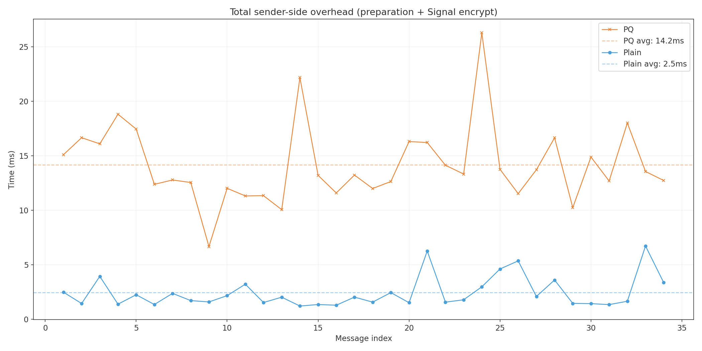
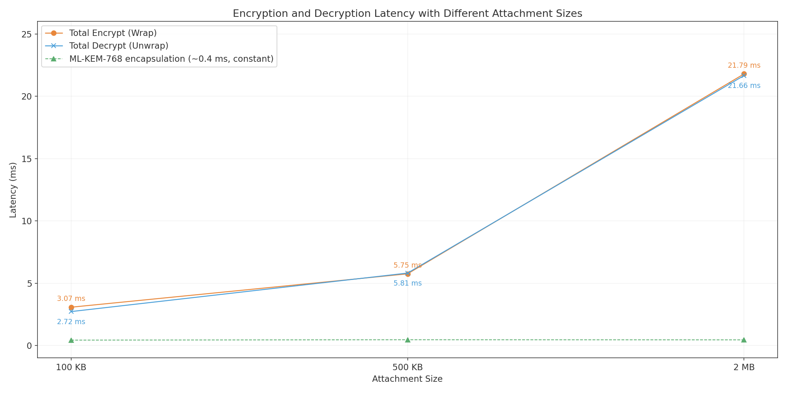
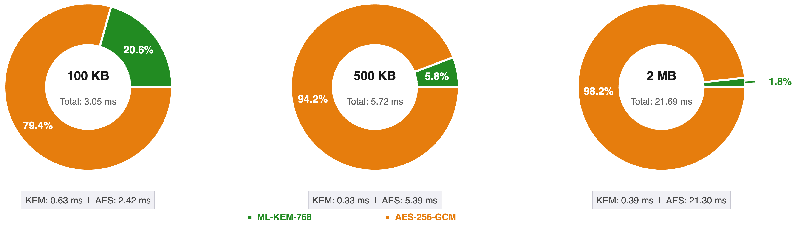
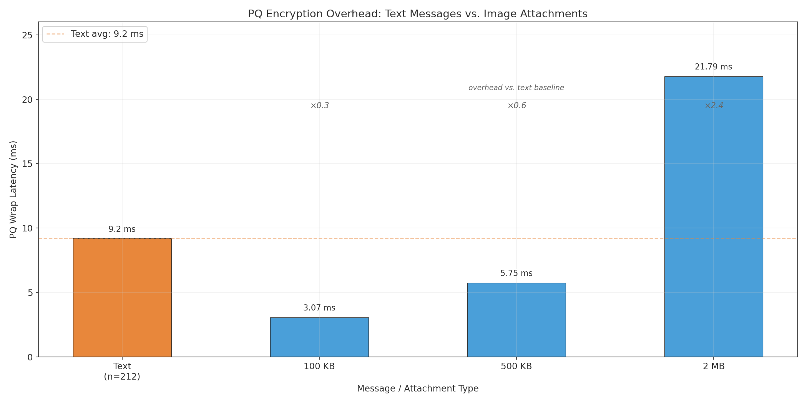
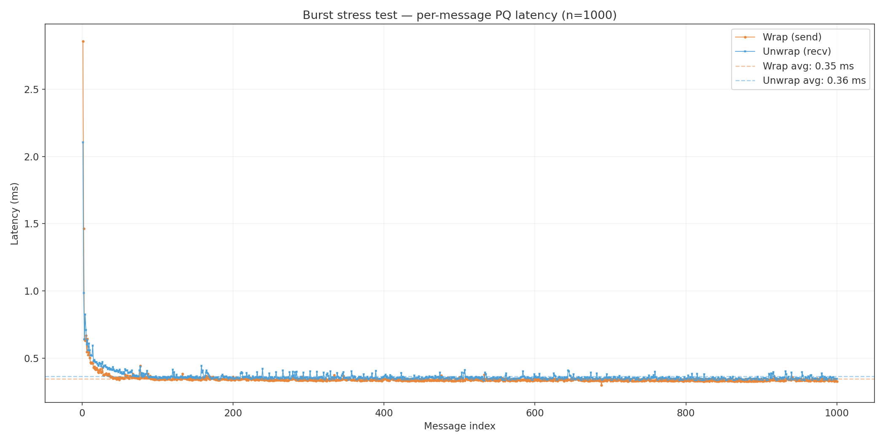
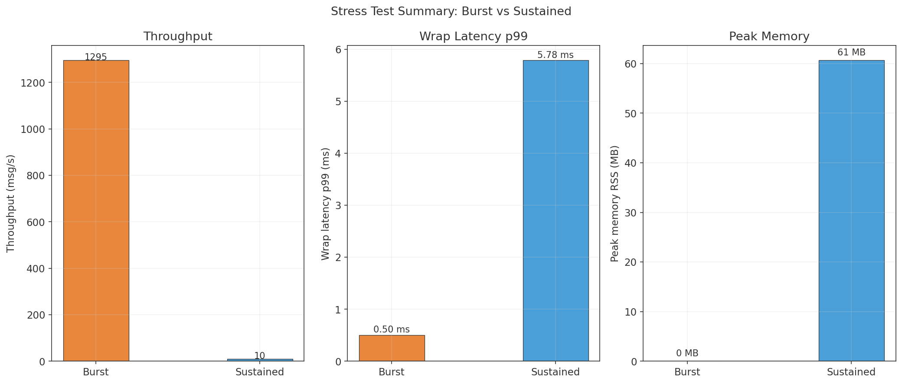
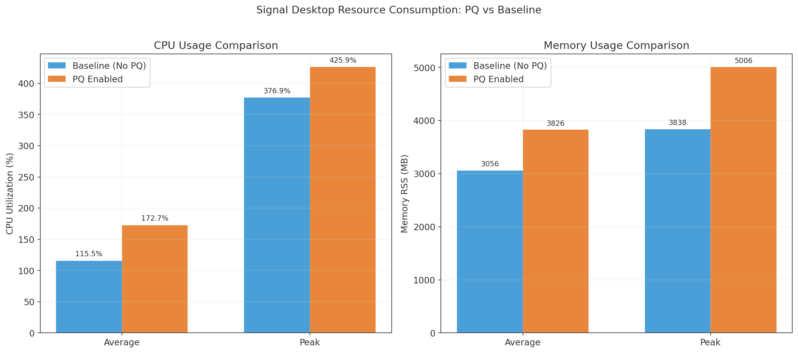

# Signal-PQC-Integration


A post-quantum encryption layer for Signal Desktop, built as part of my Final Year Project at the University of Nicosia. This adds ML-KEM-768 (CRYSTALS-Kyber) on top of Signal's existing Double Ratchet protocol, giving messages a hybrid classical+PQ encryption stack.

The idea is simple: encrypt the plaintext with ML-KEM-768 + AES-256-GCM *before* it hits the Signal protocol layer. Signal then does its usual thing on top. Neither layer replaces the other — you get both.

> **Full source:** the complete modified Signal Desktop tree lives on the [`fyp-signal-7.81.0` branch of my fork](https://github.com/Somthin2/Signal-Desktop/tree/fyp-signal-7.81.0). This repo is the distilled version — just the changed files, the benchmarks, and the results.

---

## What's in here

This repo contains the modified source files and benchmarking scripts from the project. It's structured so you can drop the modified files into a fresh Signal Desktop v7.81.0 checkout and have PQ encryption running in about 20 minutes.

```
Signal-PQC-Integration/
├── modified_files/          # The files you actually need to copy into Signal
│   ├── PQWrapper.ts         # Core PQ crypto module (ML-KEM-768 + AES-256-GCM)
│   ├── OutgoingMessage.preload.ts   # Modified send path
│   ├── MessageReceiver.preload.ts   # Modified receive path
│   └── pqBenchmarkLogger.ts         # JSONL benchmark logging
├── scripts/
│   ├── pq-bench-attachments.mjs     # Standalone attachment benchmark
│   ├── pq-stress-test.mjs           # Burst/sustained-load stress test
│   ├── create-test-images.sh        # Generate test PNG files at target sizes
│   ├── analyze-pq-bench.py          # Parse logs and produce summary tables
│   └── plot-stress-test.py          # Plot stress test results
├── results/                 # Benchmark output graphs and CSV data
│   ├── attachment_benchmark.csv
│   └── stress_test.jsonl
└── docs/
    ├── EXPERIMENT_METHODOLOGY.md
    └── images/              # Benchmark figures (as used in the paper/thesis)
```

---

## Key results

### In-app message sending

Measured across live message sends between two local Signal Desktop instances, the full sender-side overhead (protobuf encode + PQ wrap + padding + Signal encrypt) averages 14.2 ms with PQ enabled versus 2.5 ms without — an added cost of about 12 ms, far below the ~100 ms threshold users perceive as instantaneous.



### Attachment encryption

Tested on Apple M4 Pro (24 GB RAM, macOS), n=18 runs per payload size:

| Payload | PQ Wrap (avg) | PQ Unwrap (avg) | KEM overhead |
|---------|--------------|-----------------|--------------|
| 100 KB  | 3.42 ms      | 3.05 ms         | ~0.70 ms     |
| 500 KB  | 5.94 ms      | 5.98 ms         | ~0.37 ms     |
| 2 MB    | 21.76 ms     | 21.84 ms        | ~0.32 ms     |

The KEM (ML-KEM-768 encapsulate/decapsulate) cost is nearly constant regardless of payload size — around 0.3–0.7 ms. The dominant cost at larger sizes is the AES-256-GCM symmetric encryption, which scales linearly with data. For text messages the total PQ overhead is well under 5 ms.



The interesting inversion: for text messages the KEM dominates the cost, while for attachments it's a rounding error next to the AES bulk encryption.

| | |
|---|---|
|  |  |

### Stress testing

`pq-stress-test.mjs`, 60-byte messages:

| Phase | Throughput | Wrap avg | Wrap p99 |
|-------|-----------|----------|----------|
| Burst (1,000 msgs, max rate) | 1,295 msg/s | 0.35 ms | 0.50 ms |
| Sustained (10 msg/s × 60 s)  | steady 9.9 msg/s | 2.13 ms | 5.78 ms |

No latency degradation or memory growth over sustained operation (RSS stable at ~60 MB, CPU under 8%). Raw per-message data is in `results/stress_test.jsonl`.





### Resource usage

Running with the PQ layer enabled costs little beyond the crypto itself — CPU and memory stay close to the plain-Signal baseline during a 60-second messaging window:



---

## Quick start

### Prerequisites

- Node.js v20+ and pnpm
- Signal Desktop source at v7.81.0 (see [INTEGRATION_GUIDE.md](INTEGRATION_GUIDE.md))
- Python 3.8+ (for the analysis script)

### Integration

1. Clone Signal Desktop at tag `v7.81.0`
2. Copy files from `modified_files/` into the right spots (see [INTEGRATION_GUIDE.md](INTEGRATION_GUIDE.md))
3. Install the two extra npm dependencies:
   ```bash
   pnpm add @noble/post-quantum @noble/ciphers
   ```
4. Build and run two instances:
   ```bash
   pnpm run build:esbuild
   NODE_APP_INSTANCE=alice pnpm start
   NODE_APP_INSTANCE=bob pnpm start
   ```

### Running the standalone benchmark

This doesn't need the Signal app running — it tests the crypto code in isolation:

```bash
cd Signal-Desktop
node scripts/pq-bench-attachments.mjs --runs 18 --sizes 102400,524288,2097152
```

Results go to `~/SignalPQBenchmarks/`.

### Running the stress test

Also standalone — three phases: burst (1,000 messages at max rate), sustained (10 msg/s for 60 s), and combined:

```bash
cd Signal-Desktop
node scripts/pq-stress-test.mjs
# or with custom parameters:
node scripts/pq-stress-test.mjs --burst-n 500 --sustained-rate 5 --sustained-secs 30
```

Output is a JSONL log in `~/SignalPQBenchmarks/` with per-message wrap/unwrap latency plus CPU and memory samples; `scripts/plot-stress-test.py` turns it into graphs.

### Toggling PQ on/off

In `ts/textsecure/PQWrapper.ts`, flip the flag:

```typescript
export const PQ_ENABLED = true;  // set false for baseline measurements
```

Then rebuild with `pnpm run build:esbuild`.

---

## How the encryption works

```
Plaintext
   │
   ▼
[PQ Layer: ML-KEM-768 encapsulate → AES-256-GCM encrypt]
   │
   ▼
[Signal Double Ratchet (libsignal)]
   │
   ▼
Wire
```

**Wire format for PQ messages:**

```
[KIND=0x02][version][kemLen (2 bytes)][KEM ciphertext (1088 bytes)][nonce (12 bytes)][AES-GCM ciphertext]
```

**Key exchange (local test mode):**  
Each Signal instance writes its ML-KEM-768 public key to `~/SignalPQSharedKeys/` on startup. The first message to a new recipient is a handshake that includes the sender's public key:

```
[KIND=0x01][ML-KEM-768 public key (1184 bytes)][plaintext]
```

Subsequent messages use the PQ-encrypted format. The handshake is still protected by Signal's Double Ratchet — PQ is a layer on top, not a replacement.

---

## Dependencies added

Both are pure TypeScript with no native bindings:

- [`@noble/post-quantum`](https://github.com/paulmillr/noble-post-quantum) — ML-KEM-768 implementation
- [`@noble/ciphers`](https://github.com/paulmillr/noble-ciphers) — AES-256-GCM

I chose the noble libraries because they're well-audited, have no native dependencies (which matters for Electron), and the ML-KEM implementation is FIPS 203 compliant.

---

## Citation

If you use this work, please cite:

```
Pavlides, A. (2025). Post-Quantum Hybrid Encryption Integration in Signal Desktop:
A Practical ML-KEM-768 Implementation. Final Year Project, University of Nicosia.
```

---

## Authors & Contributors

**Primary Author:**
- **Athanasios Pavlides**
  - University of Nicosia, Department of Computer Science
  - Student ID: U224N2683
  - Email: thanospavlides1234@gmail.com

**Academic Supervisors & Contributors:**
- **Prof. Harald Gjermundrød**
  - Department of Computer Science
  - University of Nicosia
  - Email: gjermundrod.h@unic.ac.cy

- **Dr. Ioanna Dionysiou**
  - Department of Computer Science
  - University of Nicosia
  - Email: dionysiou.i@unic.ac.cy

---

## License

GPL-3.0 — same license as Signal Desktop itself. See [LICENSE](LICENSE).

Signal Desktop is copyright Signal Messenger, LLC. The modifications in this repository are my own work as part of a final year research project.
